

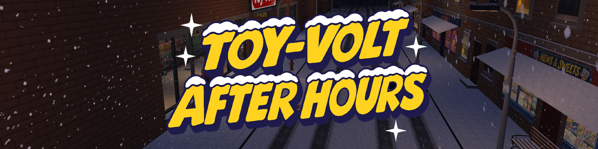

<h3>The store is closed. The R/C cars are out.</h3>

A track for RVGL: on a snowy night the cars break out of the shelves of the Toy-Volt flagship store and race back through the factory where they were built, both ways round.

 

  
  
  
  
  

  

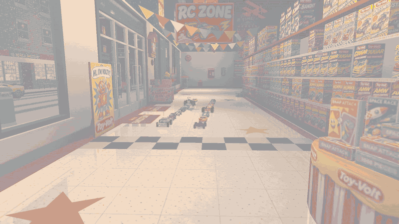

<table>
  <tr>
    <td align="center"><b>516 m</b> lap length in game</td>
    <td align="center"><b>2 storeys</b> shop and factory</td>
    <td align="center"><b>0:40.000</b> Time Trial, both ways</td>
    <td align="center"><b>17 pickups</b> and a star each way</td>
    <td align="center"><b>Reverse</b> a lap of its own</td>
  </tr>
</table>

## The lap

It starts in the shop's front aisle under the START banner, with the snowy street behind the windows, and leaves through the STAFF ONLY door into the factory. Dispatch, the assembly line and the paint line come first, then quality control, a jump back into the shop on the upper floor, and down a ramp to the start.

<table>
  <tr>
    <td width="50%">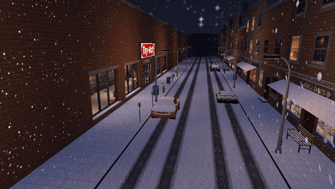 <b>Outside.</b> The shop's windows light the snowy pavement; the game's own cars are parked at the kerb.</td>
    <td width="50%">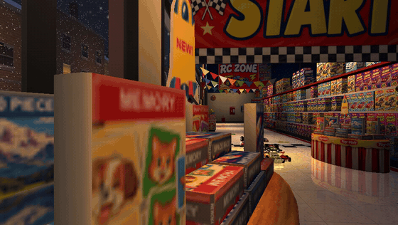 <b>The front aisle.</b> The start line under the START banner, between shelves of boxed R/C cars.</td>
  </tr>
  <tr>
    <td>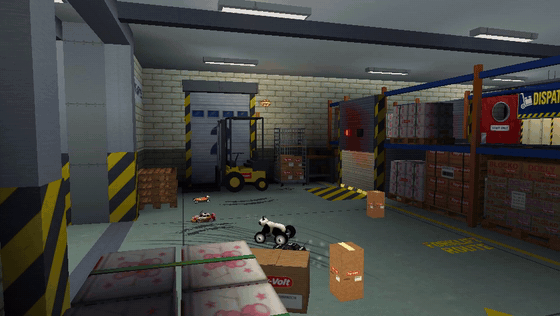 <b>Dispatch.</b> Racks, pallets and a forklift. A short cut runs straight through the cell when its shutters are up; the pickups are on the long way round.</td>
    <td>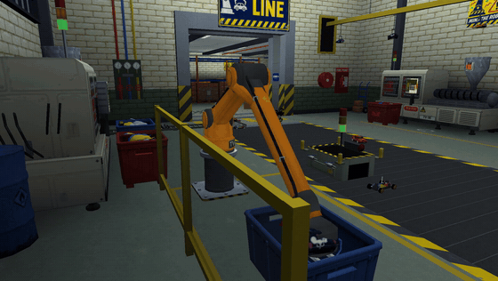 <b>The assembly line.</b> The lap rides the belt beside the row of chassis and the two robot arms.</td>
  </tr>
  <tr>
    <td>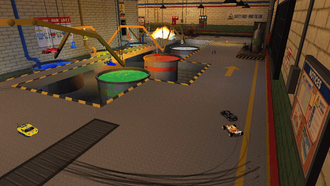 <b>The paint line.</b> A chain of hangers dips the game's own car bodies into the tanks under a catwalk. Fall in and you are put back on the track; a plank across the tanks is the short cut.</td>
    <td>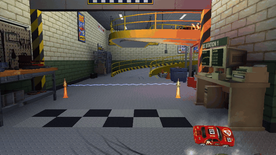 <b>Quality control.</b> One turn round the test helix, then a jump from its mouth down onto the shop's balcony.</td>
  </tr>
  <tr>
    <td>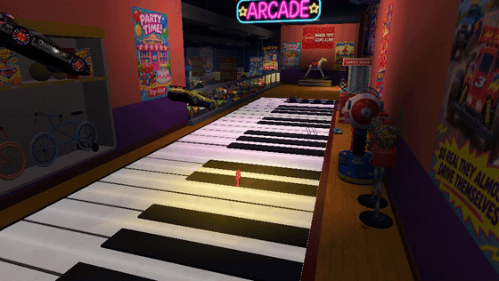 <b>The arcade.</b> The upper floor opens on giant piano keys under the neon.</td>
    <td>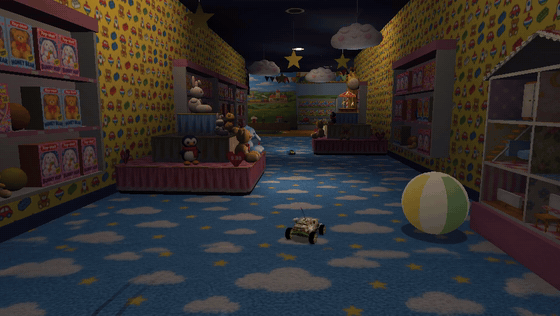 <b>The plush corner.</b> A cloud carpet among the teddy bears and the dolls' house.</td>
  </tr>
  <tr>
    <td colspan="2">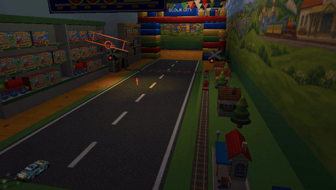 <b>The toy trains.</b> A toy road beside the railway, a plane flying overhead, then the ramp down into two hairpins between the shelves and back to the start.</td>
  </tr>
</table>

## In reverse

Not the same lap backwards. The race climbs a wave slide up to the helix's mouth, and the assembly line has broken down: the belt stopped, the cars piled up, a red alarm and two worried robot arms.

<table>
  <tr>
    <td width="50%">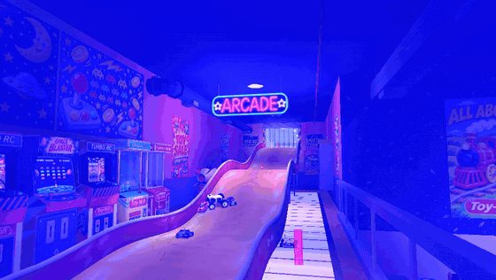 <b>The wave slide.</b> Only the reversed race climbs it.</td>
    <td width="50%">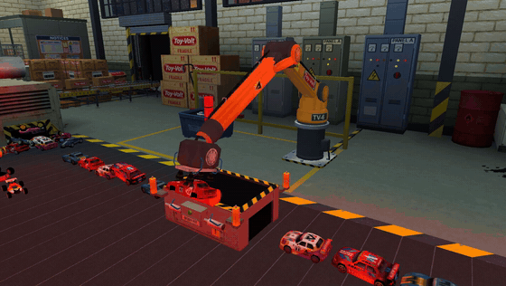 <b>The broken line.</b> The belt has stopped and the alarm is on.</td>
  </tr>
</table>

## What to expect in a race

- Two storeys, jumps and heights, and the open side of the catwalk over the paint tanks.
- Two short cuts, through the dispatch cell and across the plank; the long way round dispatch carries the pickups.
- Things that move: the paint line's hangers, the robot arms, the crane's load, the packing machine's cartons, flying toy planes, and boxes and blocks to push around.
- 17 pickups, a practice star and a race star in each direction, and direction arrows at every turn.
- The factory's own sounds, and the music of the original Toy World.

## The trailer

<a href="https://youtu.be/YtW9h2DhYM8">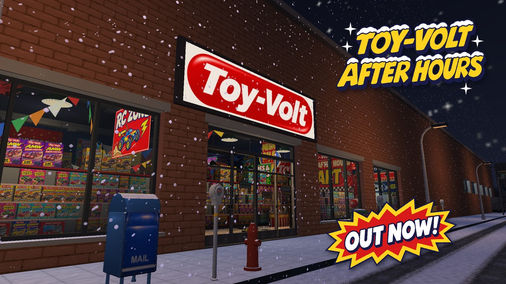</a>

## Download and install

Get `Toy-Volt_After_Hours_<version>.zip` from the [latest release](https://github.com/6up3r/rvgl-toy-volt-after-hours/releases/latest), the same file as on [Re-Volt World](https://www.revoltworld.net/dl/toy-volt-after-hours/).

Extract it into your RVGL folder so that the `levels` and `gfx` folders merge with the existing ones, or install it with the RVGL Launcher. The track is **Toy-Volt After Hours** in the track list, with the reverse in the same entry. The readme inside the archive is in `levels/tv_afterhours/`.

## Versions

| Version | Released | What changed |
| --- | --- | --- |
| [1.0](https://github.com/6up3r/rvgl-toy-volt-after-hours/releases/tag/v1.0) | 19 November 2026 | First release |

## Reporting a problem

Something looks, drives or sounds wrong? Open the [track report form](https://github.com/6up3r/rvgl-toy-volt-after-hours/issues/new?template=track.yml): one problem per report, with the spot on the lap and a screenshot where it shows. Every report is read, and the fix comes in a later release.

---

<b>Credits:</b> cars, music and the ABC block and cardboard box collisions from Re-Volt (Acclaim Studios London, 1999). Built in Blender 2.79b with Marv's Re-Volt add-on (Marvin Thiel, GPL-3.0). Textures, signs and 3D models started from OpenAI GPT and Codex output, reworked and placed by hand; sounds synthesised.

Made by <b>6Up3r</b> · also by the author: <a href="https://github.com/6up3r/rvgl-supermarket-after-hours">SuperMarket After Hours</a> · <a href="https://github.com/6up3r/rvgl-museum-after-hours">Museum After Hours</a> · <a href="https://github.com/6up3r/rvgl-car-importer-releases">RVGL Car Importer</a>

